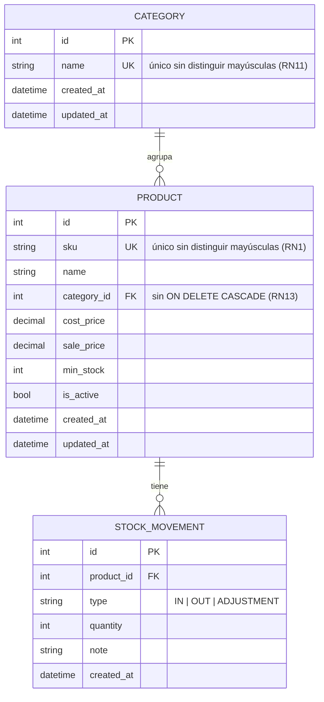

# SPEC: Inventario para negocio chico

## Problema
Un negocio chico necesita saber cuánto stock tiene de cada producto, registrar entradas y salidas, y enterarse cuándo reponer.

## Casos de uso (v1)
1. Crear, editar y desactivar productos (SKU, nombre, categoría, precio de costo, precio de venta, stock mínimo).
2. Gestionar categorías (crear, renombrar, listar, eliminar).
3. Registrar movimientos de stock: entrada (IN), salida (OUT) y ajuste (ADJUSTMENT).
4. Ver el stock actual de cada producto.
5. Ver el historial de movimientos de un producto.
6. Ver la lista de productos por debajo del stock mínimo.

## Fuera de alcance (v1)
Login y multiusuario, varios depósitos, proveedores, facturación, código de barras, reportes avanzados, importación/exportación.

## Glosario (usar siempre estos nombres)
| Término | Significado | Nombre en código |
|---|---|---|
| Producto | Artículo que el negocio compra/vende | `Product` |
| Categoría | Agrupación de productos | `Category` |
| SKU | Código único interno del producto | `sku` |
| Movimiento | Registro inmutable de un cambio de stock | `StockMovement` |
| Entrada | Ingreso de mercadería (compra) | `IN` |
| Salida | Egreso de mercadería (venta) | `OUT` |
| Ajuste | Corrección de stock (conteo, rotura, error) | `ADJUSTMENT` |
| Stock actual | Suma de movimientos del producto | `current_stock` (calculado) |
| Stock mínimo | Umbral para alertar reposición | `min_stock` |

## Modelo de datos

## Reglas de negocio
- RN1. El SKU se guarda sin espacios en los extremos y es único sin distinguir mayúsculas/minúsculas (`ABC-1` = `abc-1`). Se garantiza en el servicio y con un índice único sobre `lower(sku)` en la base.
- RN2. El stock actual NO se almacena: se calcula como `suma(IN) - suma(OUT) + suma(ADJUSTMENT)`.
- RN3. En `IN` y `OUT`, `quantity` es siempre > 0. En `ADJUSTMENT`, `quantity` es distinto de 0 y puede ser negativo (el signo es la corrección).
- RN4. Ningún movimiento puede dejar el stock de un producto en negativo.
- RN5. Los movimientos son inmutables: no se editan ni se borran. Los errores se corrigen con un ajuste.
- RN6. Los productos nunca se eliminan físicamente: se desactivan (`is_active = false`) y se pueden reactivar. Desactivar y reactivar son idempotentes.
- RN7. No se pueden registrar movimientos sobre productos inactivos.
- RN8. `cost_price` y `sale_price` >= 0. `min_stock` >= 0. Se garantiza también con CHECK en la base.
- RN9. Una categoría con productos (activos o inactivos) no se puede eliminar: `CategoryService.delete` lanza `CategoryInUseError`. La FK `products.category_id` (sin `ON DELETE CASCADE`) es la segunda defensa.
- RN10. Un producto está "bajo mínimo" cuando `current_stock <= min_stock` y está activo.
- RN11. El nombre de una categoría es obligatorio, se guarda sin espacios sobrantes y es único sin distinguir mayúsculas/minúsculas (`Ropa` = `ropa`). Se garantiza en el servicio y con un índice único sobre `lower(name)` en la base.
- RN12. El SKU es obligatorio (máx. 50 caracteres) y el nombre del producto es obligatorio (máx. 150); ambos se guardan sin espacios en los extremos.
- RN13. Todo producto pertenece a una categoría existente (`category_id` obligatorio, FK sin `ON DELETE CASCADE`).
- RN14. `min_stock` es un entero >= 0 con valor por defecto 0. `is_active` es `true` por defecto. `cost_price` y `sale_price` son obligatorios.
- RN15. El listado de productos se puede filtrar por categoría y por estado (activo / inactivo / todos).
- RN16. Si `sale_price < cost_price`, la pantalla de guardado muestra la advertencia «El precio de venta es menor al costo». Es solo informativa: no bloquea el guardado ni en el servicio ni en la API. La decisión se calcula en el servidor (`ProductService.has_price_warning`).

## Decisiones tomadas
- Stock calculado desde movimientos (trazabilidad total). Si hay problemas de performance, se agrega una columna cacheada más adelante.
- Dinero con `Numeric(12, 2)`, nunca float.
- SQLite en desarrollo; el código debe funcionar igual en PostgreSQL.

## Plan de rebanadas verticales
1. Categorías (1a) + productos (1b): base, servicio, API, UI.
2. Movimientos de stock + cálculo de stock actual + validaciones RN3 a RN7.
3. Historial por producto.
4. Alertas de stock bajo mínimo.
5. Pulido: errores, empty states, README.

## Puntos abiertos
- Rebanada 2: revisar si el SKU debe poder editarse cuando el producto ya tiene movimientos. (En 1b el SKU es editable, con la misma validación de unicidad.)
