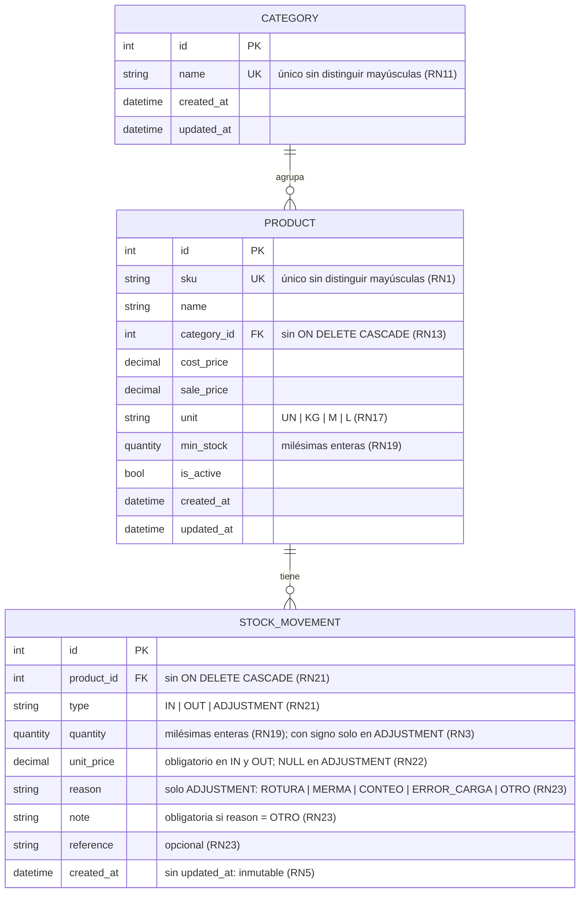

# SPEC: Inventario para negocio chico

## Problema
Un negocio chico necesita saber cuánto stock tiene de cada producto, registrar entradas y salidas, y enterarse cuándo reponer.

## Casos de uso (v1)
1. Crear, editar y desactivar productos (SKU, nombre, categoría, unidad de medida, precio de costo, precio de venta, stock mínimo).
2. Gestionar categorías (crear, renombrar, listar, eliminar).
3. Registrar movimientos de stock: entrada (IN), salida (OUT) y ajuste (ADJUSTMENT).
4. Ver el stock actual de cada producto.
5. Ver el historial de movimientos de un producto.
6. Ver la lista de productos por debajo del stock mínimo.

## Fuera de alcance (v1)
Login y multiusuario, varios depósitos, proveedores, facturación, código de barras, reportes avanzados, importación/exportación.

## Glosario (usar siempre estos nombres)
| Término | Significado | Nombre en código |
|---|---|---|
| Producto | Artículo que el negocio compra/vende | `Product` |
| Categoría | Agrupación de productos | `Category` |
| SKU | Código único interno del producto | `sku` |
| Movimiento | Registro inmutable de un cambio de stock | `StockMovement` |
| Libro mayor | La tabla de movimientos: fuente única del stock; solo se agregan filas | `stock_movements` |
| Entrada | Ingreso de mercadería (compra) | `IN` |
| Salida | Egreso de mercadería (venta) | `OUT` |
| Ajuste | Corrección de stock (conteo, rotura, error) | `ADJUSTMENT` |
| Precio unitario | Costo de compra (en `IN`) o precio de venta (en `OUT`) del momento del movimiento | `unit_price` |
| Motivo de ajuste | Por qué se ajusta: `ROTURA`, `MERMA`, `CONTEO`, `ERROR_CARGA`, `OTRO` | `reason` |
| Nota | Texto libre del movimiento; obligatoria si el motivo es `OTRO` | `note` |
| Referencia | Dato opcional del documento de origen (nº de remito, factura del proveedor) | `reference` |
| Stock actual | Suma de movimientos del producto | `current_stock` (calculado) |
| Stock mínimo | Umbral para alertar reposición | `min_stock` |
| Unidad de medida | Unidad en que se cuenta un producto: `UN` (unidades), `KG`, `M`, `L` | `unit` |
| Cantidad | Valor con 3 decimales; en la base son milésimas enteras (1,5 -> 1500) | `Quantity` |

## Modelo de datos

## Reglas de negocio
- RN1. El SKU se guarda sin espacios en los extremos y es único sin distinguir mayúsculas/minúsculas (`ABC-1` = `abc-1`). Se garantiza en el servicio y con un índice único sobre `lower(sku)` en la base.
- RN2. El stock actual NO se almacena: se calcula como `suma(IN) - suma(OUT) + suma(ADJUSTMENT)`.
- RN3. En `IN` y `OUT`, `quantity` es siempre > 0. En `ADJUSTMENT`, `quantity` es distinto de 0 y puede ser negativo (el signo es la corrección). La magnitud se valida con `validate_quantity` según la unidad del producto (RN18); en `ADJUSTMENT`, sobre el valor absoluto.
- RN4. Ningún movimiento puede dejar el stock de un producto en negativo: una salida o un ajuste que lo haga se rechaza con `InsufficientStockError` (HTTP 409). Dejarlo en exactamente 0 es válido.
- RN5. Los movimientos son inmutables: no se editan ni se borran. No tienen `updated_at` y no existe UPDATE ni DELETE de movimientos: ni endpoints ni métodos de repositorio. Los errores se corrigen con un ajuste.
- RN6. Los productos nunca se eliminan físicamente: se desactivan (`is_active = false`) y se pueden reactivar. Desactivar y reactivar son idempotentes.
- RN7. No se pueden registrar movimientos sobre productos inactivos (`InactiveProductError`, HTTP 409). Su stock actual se sigue pudiendo consultar.
- RN8. `cost_price` y `sale_price` >= 0. `min_stock` >= 0 (cantidad, ver RN18). Se garantiza también con CHECK en la base.
- RN9. Una categoría con productos (activos o inactivos) no se puede eliminar: `CategoryService.delete` lanza `CategoryInUseError`. La FK `products.category_id` (sin `ON DELETE CASCADE`) es la segunda defensa.
- RN10. Un producto está "bajo mínimo" cuando `current_stock <= min_stock` y está activo.
- RN11. El nombre de una categoría es obligatorio, se guarda sin espacios sobrantes y es único sin distinguir mayúsculas/minúsculas (`Ropa` = `ropa`). Se garantiza en el servicio y con un índice único sobre `lower(name)` en la base.
- RN12. El SKU es obligatorio (máx. 50 caracteres) y el nombre del producto es obligatorio (máx. 150); ambos se guardan sin espacios en los extremos.
- RN13. Todo producto pertenece a una categoría existente (`category_id` obligatorio, FK sin `ON DELETE CASCADE`).
- RN14. `min_stock` es una cantidad >= 0 (válida para la unidad del producto, RN18) con valor por defecto 0. `is_active` es `true` por defecto. `cost_price` y `sale_price` son obligatorios.
- RN15. El listado de productos se puede filtrar por categoría y por estado (activo / inactivo / todos).
- RN16. Si `sale_price < cost_price`, la pantalla de guardado muestra la advertencia «El precio de venta es menor al costo». Es solo informativa: no bloquea el guardado ni en el servicio ni en la API. La decisión se calcula en el servidor (`ProductService.has_price_warning`).
- RN17. Todo producto tiene una unidad de medida (`unit`, obligatoria, máx. 5 caracteres): `UN`, `KG`, `M` o `L`. Valor por defecto `UN`, también como `server_default` para los productos existentes. Se garantiza con CHECK `unit IN ('UN','KG','M','L')` en la base.
- RN18. `UN` solo admite cantidades enteras; `KG`, `M` y `L` admiten hasta 3 decimales. Una cantidad nunca es negativa ni tiene más de 3 decimales ni es NaN/infinita. La regla vive en una función pura reutilizable (`validate_quantity(unit, quantity)`), usada hoy para `min_stock` y mañana para los movimientos (rebanada 2b). Si `min_stock` tiene decimales, la unidad del producto tiene que admitirlos (también al cambiar la unidad).
- RN19. Las cantidades se guardan como entero en milésimas (`Quantity`: `Decimal` con 3 decimales en Python, `BigInteger` en la base; 1,5 -> 1500), así las sumas en SQL son exactas. Nunca `float`.
- RN20. Entrada de cantidades en formularios: no se aceptan separadores de miles. Un único separador (coma o punto) es el decimal (`1,5` = `1.5` = 1,5; `1.500` = 1,5). Con más de un separador (`1.500,5`, `1,500.5`) se rechaza con un mensaje claro. Tras guardar, la pantalla muestra el valor interpretado con su unidad (p. ej. «1.5 KG»).
- RN21. `type` de un movimiento es `IN`, `OUT` o `ADJUSTMENT` (`String` con CHECK, no Enum de base). `product_id` es FK a `products.id` sin `ON DELETE CASCADE` (los productos nunca se borran, RN6) y con índice. Las combinaciones válidas de RN3, RN22 y RN23 se garantizan también con CHECK en la base, no solo en el servicio.
- RN22. `unit_price` es `Numeric(12, 2)` >= 0. Es obligatorio en `IN` (costo unitario de compra) y en `OUT` (precio unitario de venta), y debe ser NULL en `ADJUSTMENT` (ni siquiera 0). Es una foto del momento: no cambia si después cambia el precio del producto, y registrar un movimiento no modifica `cost_price` ni `sale_price` del producto.
- RN23. `reason` es obligatorio solo en `ADJUSTMENT` y de una lista fija (`ROTURA`, `MERMA`, `CONTEO`, `ERROR_CARGA`, `OTRO`); en `IN` y `OUT` es NULL. `note` es texto libre (máx. 500 caracteres): obligatoria, no vacía tras `trim`, cuando `reason` es `OTRO`; opcional en el resto. `reference` es texto opcional (máx. 100 caracteres) y hoy es solo un dato. `note` y `reference` se guardan sin espacios en los extremos y vacíos como NULL.
- RN24. El stock actual (RN2) se calcula en SQL sobre las milésimas enteras (`COALESCE(SUM(...), 0)`): nunca es una columna ni se suma con `float`. El listado de productos lo trae con una sola consulta agrupada por producto (sin N+1).
- RN25. RN4 se evalúa en la misma transacción que el INSERT: el servicio calcula el stock y registra el movimiento con un único `commit()`, y si algo falla no se persiste nada. No hay protección contra escrituras concurrentes porque el sistema es de un solo usuario.
- RN26. `StockMovementService.register_movement(...)` es el único punto de escritura de movimientos: todas las reglas (RN3, RN4, RN7, RN22, RN23) viven ahí, y la API (`POST /api/products/{id}/movements`, acepta los tres tipos) y las pantallas lo llaman. No hay PUT, PATCH ni DELETE de movimientos (RN5); el `GET` del historial por producto es de la rebanada 3. Además solo expone lecturas de stock (`current_stock`, `current_stock_by_product`).
- RN27. La unidad de un producto que ya tiene movimientos no se puede cambiar: se rechaza con `UnitChangeBlockedError` (HTTP 409), aunque la unidad nueva sea más permisiva. Los movimientos guardan cantidades válidas para la unidad con que se cargaron (p. ej. 1,5 `KG` no existe en `UN`). Sin movimientos, el cambio sigue permitido (RN18 revalida `min_stock`). Mantener la misma unidad y editar el resto de los campos siempre se puede.
- RN28. El SKU sigue siendo editable aunque el producto tenga movimientos (con la misma validación de unicidad, RN1): los movimientos apuntan al producto por `id`, no por SKU, así que renombrar el SKU no altera el libro mayor.

## Decisiones tomadas
- Stock calculado desde movimientos (trazabilidad total). Si hay problemas de performance, se agrega una columna cacheada más adelante.
- Dinero con `Numeric(12, 2)`, nunca float.
- Cantidades como `Quantity`: milésimas enteras en la base (`BigInteger`, no `Integer`: en PostgreSQL son 32 bits y las sumas podrían desbordar), `Decimal` en Python. Nunca `float`.
- SQLite en desarrollo; el código debe funcionar igual en PostgreSQL.

## Plan de rebanadas verticales
1. Categorías (1a) + productos (1b): base, servicio, API, UI.
2. Movimientos de stock:
   - 2a. Unidades de medida y cantidades decimales en `Product` (RN17 a RN20). Sin movimientos todavía.
   - 2b. Movimientos + cálculo de stock actual + validaciones RN3 a RN7.
3. Historial por producto.
4. Alertas de stock bajo mínimo.
5. Pulido: errores, empty states, README.

## Puntos abiertos
- Sistema local de un solo usuario; sin integración con otros módulos.

## Mejoras futuras
- Registrar un ajuste por conteo indicando el stock real: el sistema calcularía la diferencia contra el stock actual y la registraría como `ADJUSTMENT` con motivo `CONTEO`. (No implementado.)
